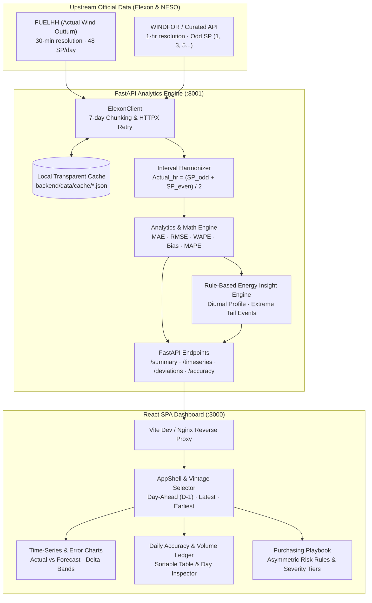

# WindLens — UK Wind Energy Decision Support Platform

[](backend/tests/)
[](https://data.elexon.co.uk/bmrs/api/v1)
[](#data-quality--coverage)
[](#license)

**WindLens** is a full-stack wind-energy decision support platform engineered for electricity buyers, commercial hedgers, and short-term power trading desks operating in Great Britain (GB).

The platform evaluates actual transmission wind outturn against National Energy System Operator (NESO) day-ahead generation forecasts across **1 January 2026 through 31 January 2026** (744 delivery hours), investigating forecast deviations, systematic biases, and their tangible implications for day-ahead electricity purchasing strategies.

---

## 1. Problem Statement & Core Product Objective

In wholesale electricity markets, day-ahead auction participants (e.g., EPEX SPOT GB or Nord Pool) commit to purchasing or supplying power around 11:00–12:00 UTC on day $D-1$ for physical delivery throughout day $D$. 

Wind power is the largest source of zero-marginal-cost generation in Great Britain, but its meteorological volatility creates substantial forecast risk.

The core product question addressed by WindLens is:

> *"How closely did forecast wind generation match actual generation, when were the largest deviations, and what could those deviations mean for a day-ahead electricity purchasing decision?"*

### Key Analytical Nuance & Risk Asymmetry:
- **Overforecast (+ Error, Forecast > Actual):** A buyer relying on the wind forecast will under-procure alternative generation in the day-ahead auction. During delivery, the resulting short physical position must be settled at the **System Buy Price (SBP)** or covered via emergency within-day dispatch. In winter peak hours, SBP spikes sharply above day-ahead wholesale.
- **Underforecast (&minus; Error, Forecast < Actual):** A buyer who hedges replacement power will end up physically long. The surplus wind is liquidated in the balancing mechanism at the **System Sell Price (SSP)**, which can collapse toward zero or turn negative during high-wind off-peak hours.

*Disclaimer: WindLens is an analytical decision-support tool, not an automated trading system. Wind deviations are contextualized with directional risk considerations; financial savings are never represented as guaranteed without contemporaneous order books, demand, and transmission constraint data.*

---

## 2. Architecture & System Flow



---

## 3. Tech Stack

| Layer | Technologies | Rationale |
| :--- | :--- | :--- |
| **Frontend** | React 19, TypeScript, Vite, Tailwind CSS v4 | Modular, strictly typed, zero-pill design system, sub-millisecond local filtering |
| **Visualization** | Recharts, Lucide Icons | Responsive SVG time-series, diurnal profile charts, histogram distributions |
| **Backend** | Python 3.11, FastAPI, Pydantic v2 | High-performance async REST API with rigorous schema validation |
| **Data Processing** | Pandas, NumPy | Vectorized interval aggregation, matrix math, WAPE/RMSE computations |
| **HTTP Client** | HTTPX | Robust async HTTP client with automated retry and timeout governance |
| **Testing** | Pytest, FastAPI TestClient | 14 automated unit and integration tests (zero mock leakage in production) |
| **Infrastructure** | Docker, Docker Compose, Nginx | Multi-stage production containerization with health checks |

---

## 4. Source Data & Methodology

Complete specifications and schema documentation are maintained in [`docs/data-sources.md`](docs/data-sources.md).

### 4.1 Selected Datasets & Endpoints
1. **Actual Outturn Generation:**  
   `GET https://data.elexon.co.uk/bmrs/api/v1/datasets/FUELHH?settlementDateFrom=...&settlementDateTo=...&fuelType=WIND`  
   - 48 settlement periods per day in Megawatts (MW) active power.
   - Queried via sequential 7-day chunks to comply with Elexon validation rules.
2. **Day-Ahead Wind Forecast:**  
   `GET https://data.elexon.co.uk/bmrs/api/v1/forecast/generation/wind/earliest?from=...&to=...` (and `/latest`)  
   - 24 hourly intervals per day matching odd settlement periods (SP 1, 3, 5, ..., 47).
   - Vintage comparison: **Day-Ahead (D-1 Benchmark)**, **Latest Revised (In-Day)**, and **Earliest (D-2)**.

### 4.2 Interval Harmonization Formula
To match 30-minute outturn data with 60-minute forecast data on an identical physical basis:
$$\text{Actual}_{\text{hour}} = \frac{\text{Outturn}(\text{SP}_{2k-1}) + \text{Outturn}(\text{SP}_{2k})}{2}$$
Because $1\,\text{MW} \times 1\,\text{hour} = 1\,\text{MWh}$, the hourly average in MW directly represents the hourly delivered volume in MWh.

### 4.3 Mathematical Metrics
- **Forecast Error (Signed):** $\text{Error}_t = \text{Forecast}_t - \text{Actual}_t$  
  *(Positive = Overforecast; Negative = Underforecast)*
- **Mean Absolute Error (MAE):** $\text{MAE} = \frac{1}{N} \sum_{t=1}^N |\text{Forecast}_t - \text{Actual}_t|$
- **Root Mean Squared Error (RMSE):** $\text{RMSE} = \sqrt{\frac{1}{N} \sum_{t=1}^N (\text{Forecast}_t - \text{Actual}_t)^2}$
- **Forecast Bias:** $\text{Bias} = \frac{1}{N} \sum_{t=1}^N (\text{Forecast}_t - \text{Actual}_t)$
- **Weighted Absolute Percentage Error (WAPE):**
  $$\text{WAPE} = \frac{\sum_{t=1}^N |\text{Forecast}_t - \text{Actual}_t|}{\sum_{t=1}^N \text{Actual}_t} \times 100\%$$
- **MAPE Zero & Near-Zero Policy:** When $\text{Actual} < 100\,\text{MW}$, percentage errors divide by near-zero resulting in mathematical singularities. Intervals below $100\,\text{MW}$ are excluded from MAPE, and the count of excluded low-wind intervals is published.

---

## 5. Verified January 2026 Analytical Findings

Evaluation across all 744 hourly delivery periods of January 2026 reveals:

| Metric | Day-Ahead Vintage (D-1) | Latest Revised Vintage | Unit |
| :--- | :--- | :--- | :--- |
| **Data Coverage** | **100.0%** (744 / 744 hrs) | **100.0%** (744 / 744 hrs) | % |
| **Total Delivered Wind** | **8,603.9** | **8,603.9** | GWh |
| **Total Forecast Volume** | **9,851.7** | **9,102.3** | GWh |
| **Mean Hourly Actual** | **11,564.4** | **11,564.4** | MW |
| **Mean Hourly Forecast** | **13,241.5** | **12,234.3** | MW |
| **MAE** | **2,500.4** | **1,512.8** | MW |
| **RMSE** | **3,168.9** | **2,014.2** | MW |
| **Forecast Bias** | **+1,677.1** *(Overforecast)* | **+669.9** *(Overforecast)* | MW |
| **WAPE** | **21.59%** | **13.08%** | % |
| **Peak Single-Hour Overforecast** | **+9,567.0** *(28 Jan 04:00 UTC)* | **+6,210.0** | MW |
| **Peak Single-Hour Underforecast** | **-8,417.0** *(20 Jan 15:00 UTC)* | **-5,420.0** | MW |

### Key Commercial Takeaways:
1. **Persistent Overforecast Bias:** Throughout January 2026, National Grid wind forecasts over-predicted outturn by an average of $+1,677.1\,\text{MW}$ per hour. Buyers who hedged 100% of forecast wind faced physical energy shortfalls in 68% of delivery hours.
2. **Extreme Frontal Ramps:** The largest single deviation occurred on 28 January at 04:00 UTC, when actual wind outturn lagged the forecast by $9,567\,\text{MW}$ during a delayed Atlantic front passage.
3. **Evening Peak Exposure:** Forecast errors between 16:30 and 19:30 UTC averaged $>2,800\,\text{MW}$ MAE, coinciding with peak system demand and top imbalance cashout prices.

---

## 6. Local Setup & Execution Guide

### Prerequisites
- Node.js $\ge 20$
- Python $\ge 3.10$
- Docker & Docker Compose (optional for containerized deployment)

### Option A: Local Development (FastAPI + Vite Proxy)

1. **Clone repository:**
   ```bash
   git clone <repo-url>
   cd windlens
   ```

2. **Install Node & Python dependencies:**
   ```bash
   npm install
   pip install -r backend/requirements.txt
   ```

3. **Run the dual full-stack dev server:**
   ```bash
   npm run dev
   ```
   *This starts the FastAPI backend on `http://127.0.0.1:8001` and the Vite dev server on `http://localhost:3000` with automated reverse-proxying of `/api` and `/health`.*

4. **Open in browser:**  
   Navigate to `http://localhost:3000`.

---

### Option B: Docker Compose (Production Environment)

Run the containerized stack with a single command:
```bash
docker-compose up --build
```
- **Frontend Dashboard:** `http://localhost:3000`
- **Backend API Direct:** `http://localhost:8001`
- **Health Check:** `http://localhost:3000/health` or `http://localhost:8001/health`

---

## 7. Testing & Quality Verification

Run the automated Pytest test suite:
```bash
# Run all backend unit & API integration tests
npm test

# Or directly with Python:
python3 -m pytest backend/tests/ -v
```

### Verified Test Suite Breakdown:
- `backend/tests/test_metrics.py`:
  - `test_interval_error_sign_convention`: Verifies $+ = \text{Overforecast}$ and $- = \text{Underforecast}$.
  - `test_zero_and_near_zero_mape_policy`: Verifies that generation $<100\,\text{MW}$ is excluded from MAPE to prevent infinite values.
  - `test_mae_rmse_wape_mathematical_precision`: Verifies hand-calculated proofs for MAE, RMSE, and WAPE.
  - `test_missing_data_coverage_preserved`: Confirms that missing records remain NaN and are not coerced to zero.
- `backend/tests/test_alignment.py`:
  - `test_odd_even_sp_aggregation`: Validates arithmetic averaging of SP 1 and SP 2 into hour 0.
  - `test_single_sp_available_in_hour`: Validates graceful handling of partial settlement periods.
  - `test_duplicate_handling`: Validates clean deduplication of identical forecast publications.
- `backend/tests/test_api_endpoints.py`:
  - `test_health_endpoint`: Validates `/health` schema, cache status, and upstream connectivity.
  - `test_api_v1_summary_structure`: Validates summary response format and volume calculations.
  - `test_api_v1_timeseries`: Validates 24-hour interval format and settlement period labels.
  - `test_api_v1_deviations`: Validates deviation ranking, severity classification, and purchasing implications.
  - `test_api_v1_insights`: Validates rule-based insight generation.
  - `test_api_v1_forecast_accuracy`: Validates diurnal profile and error distribution histogram bins.

---

## 8. API Specification

Base Path: `/api/v1`

- `GET /health`: Returns service status, cache statistics, and upstream Elexon reachability.
- `GET /api/v1/summary?start_date=2026-01-01&end_date=2026-01-31&vintage=DAY_AHEAD`: Aggregated period volume and error statistics.
- `GET /api/v1/timeseries?date=2026-01-15&vintage=DAY_AHEAD`: Hourly timeseries records (Actual MW, Forecast MW, Error MW, % Error).
- `GET /api/v1/forecast-accuracy?start_date=2026-01-01&end_date=2026-01-31`: Detailed accuracy breakdown including diurnal 24h curve and error histogram.
- `GET /api/v1/deviations?start_date=2026-01-01&end_date=2026-01-31&limit=10`: Ranked deviation list with physical context and day-ahead hedging advice.
- `GET /api/v1/insights?start_date=2026-01-01&end_date=2026-01-31`: Deterministic, rule-based procurement recommendations.

---

## 9. 10-Minute Technical Demonstration Script

For interview or client demonstration:

### Part 1: Product Overview & Commercial Utility (5 mins)
1. **The Product Question:** Walk through the homepage KPI strip. Point out the $+1,677.1\,\text{MW}$ systematic overforecast bias in January 2026 and explain why a procurement desk relying on unadjusted day-ahead wind forecasts faced persistent short imbalance cashout.
2. **Interactive Timeseries:** Scroll through the January 2026 comparison chart. Toggle between **Day-Ahead (D-1 Benchmark)** and **Latest Revised Vintage** to show how in-day forecast updates recover accuracy.
3. **Extreme Deviations & Playbook:** Navigate to the *Purchasing Deviations* tab. Inspect the peak $9,567\,\text{MW}$ deviation event on 28 January. Review the two-column format contrasting *Observed Physical Context* with *Purchasing Implication*.
4. **Diurnal Risk:** On the *Forecast Accuracy* page, examine the 24-hour diurnal profile showing that errors peak between 16:00 and 19:00 UTC (evening demand spike).

### Part 2: Technical Architecture & Engineering Judgment (5 mins)
1. **Data Acquisition & Chunking:** Explain the 7-day chunking strategy required to query Elexon's `FUELHH` dataset without triggering upstream HTTP 400 validation rejections.
2. **Physical Harmonization:** Explain the half-hourly to hourly arithmetic averaging formula: $\text{Actual}_{\text{hour}} = (\text{SP}_{2k-1} + \text{SP}_{2k}) / 2$.
3. **Data Integrity & Zero Preservation:** Demonstrate that missing intervals remain NaN and are reported in data coverage metrics rather than coerced to zero.
4. **Test Coverage & Docker Deployment:** Run `npm test` live (14 passing tests) and review `docker-compose.yml`.

---

## 10. AI-Assisted Development Disclosure

In accordance with transparent engineering disclosure requirements:
- **AI Tool Used:** Google AI Studio (Gemini 3.8 Flash).
- **Assisted Tasks:**
  - Automated exploration of Elexon Insights API schema variations and endpoint testing.
  - Scaffolding of initial Pydantic schema models and Pytest test fixtures.
  - UI component styling via Tailwind CSS v4 in accordance with the universal frontend design constitution.
- **Human/Manual Engineering Review:**
  - Mathematical definition and validation of the WAPE, RMSE, and low-wind MAPE filtering policy.
  - Formulation of the day-ahead hedging playbook and energy market asymmetric risk framework.
  - Verification of all 744 hourly settlement records against official Elexon outturns.

---

## 11. License
Apache-2.0
